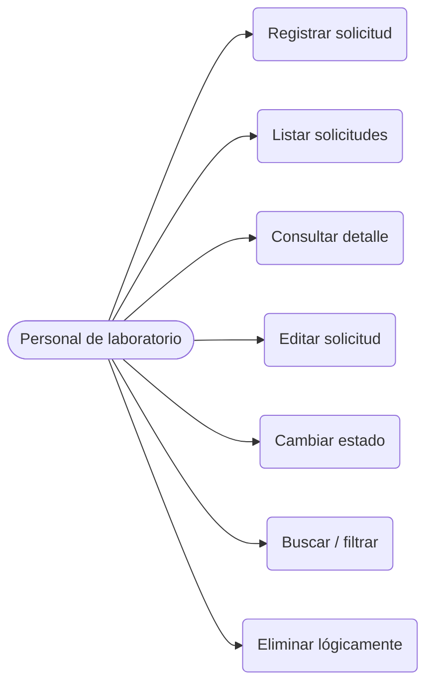
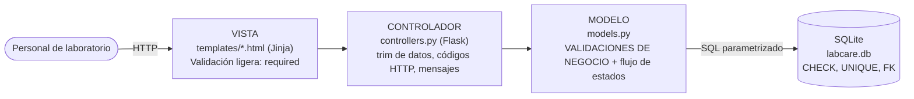

# ANÁLISIS - LabCare (módulo de solicitudes de mantenimiento)

## Actor y alcance
- **Actor principal:** Personal de laboratorio (los responsables de soporte usan las mismas acciones).
- **Problema:** las fallas se reportan por mensajes y hojas de cálculo; se pierden solicitudes y no se conoce su estado.
- **Alcance:** módulo de solicitudes (CRUD, estados, búsqueda/filtros). El catálogo de equipos solo se consulta.

## Requerimientos funcionales implementados
RF-01 Listar solicitudes activas · RF-02 Registrar · RF-03 Consultar detalle · RF-04 Editar ·
RF-05 Cambiar estado · RF-06 Eliminación lógica · RF-07 Buscar · RF-08 Filtrar ·
RF-09 Mensajes de éxito/validación/error · RF-10 Persistencia en SQLite.

## Reglas de negocio
- Equipo: debe existir y estar `OPERATIVO` (supuesto: "disponible" = operativo).
- Solicitante: mínimo 3 caracteres tras `trim`. Descripción: mínimo 10 tras `trim`.
- Prioridad: `BAJA`, `MEDIA` o `ALTA`. Estado inicial: `PENDIENTE`.
- Código autogenerado `SOL-AAAAMMDD-XXX`, único.
- Transiciones: `PENDIENTE → EN_PROCESO | CANCELADA`; `EN_PROCESO → RESUELTA | CANCELADA`; `RESUELTA` y `CANCELADA` son finales.
- Eliminación lógica: `activo = 0`, nunca `DELETE`.
- La edición no cambia id, código ni fecha de registro.

## Diagrama de casos de uso (UML simplificado)

## Esquema C4 de contenedores / MVC

**Dónde se validan los datos:** (1) navegador: solo `required`; (2) **servidor: `models.validar()` y `models.cambiar_estado()`** (la validación que cuenta); (3) base de datos: `NOT NULL`, `UNIQUE`, `FOREIGN KEY`, `CHECK`.

## Relación de tablas
`equipo (1) ──── (N) solicitud` mediante `solicitud.equipo_id → equipo.id`.
